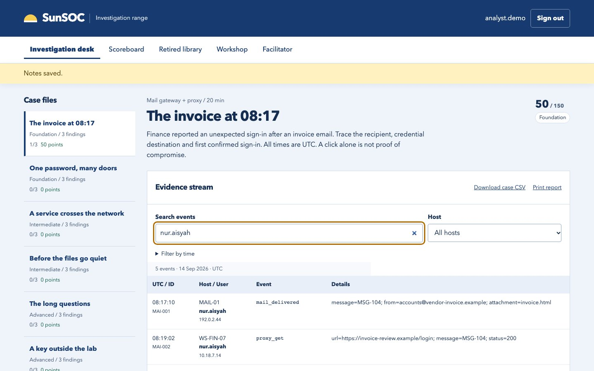
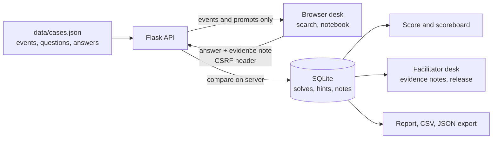
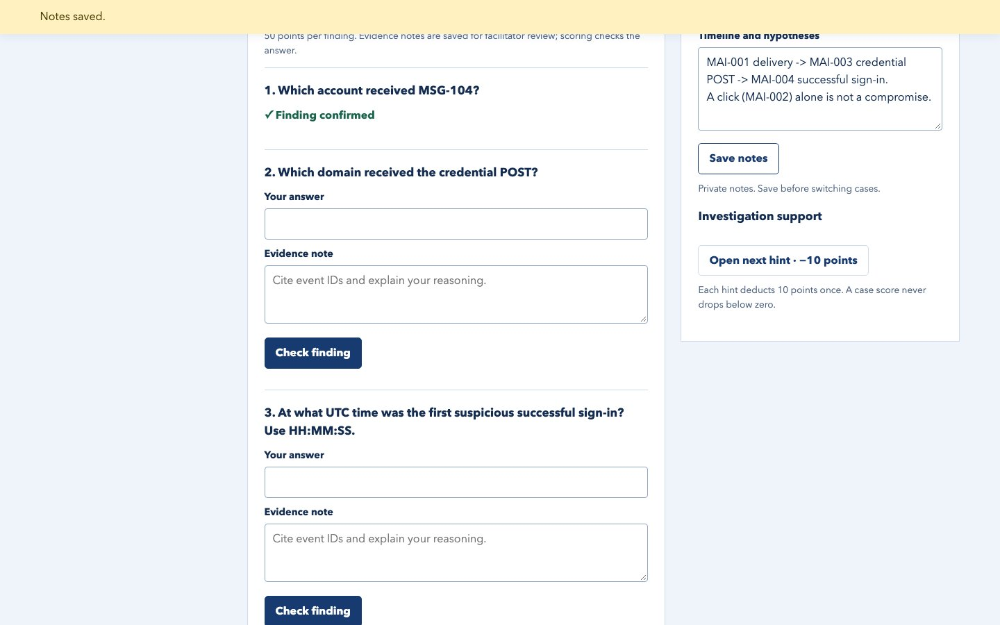
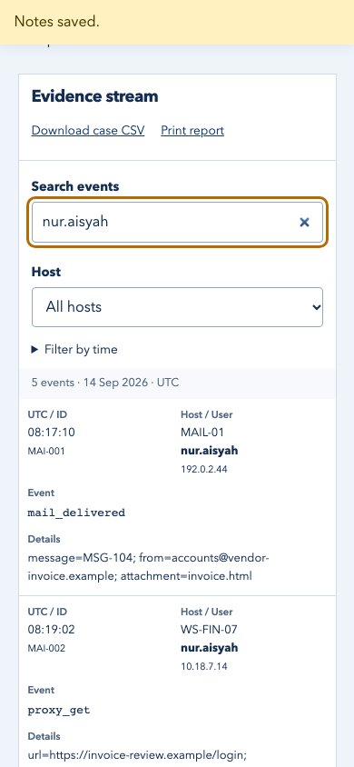

# SunSOC

A click is not a compromise. SunSOC is a local investigation range where learners prove what happened in an incident, one log event at a time, and every answer needs an evidence note.



## What it does

- Eight original synthetic incidents (157 log events, 24 scored findings) covering phishing, password spraying, lateral movement, backup deletion, DNS tunnelling, cloud-key misuse, data copying and a web shell.
- A searchable event stream per case: filter by user, IP, event ID, host or UTC time.
- Each finding needs an answer **and** an evidence note citing event IDs. Correct answers score 50 points once; wrong answers cost nothing; each of two hints costs 10.
- A notebook for the timeline, a printable case report, CSV and JSON exports, and a local scoreboard.
- A facilitator desk, behind a separate token, to read learners' evidence notes, see local metrics and release solutions after a session.

## The idea: three claims, three events

The first case, "The invoice at 08:17", is built around one distinction. A phishing email leads to three separate claims, and each needs its own event:

| Claim | Event that proves it |
| --- | --- |
| The email was **delivered** | `mail_delivered` on the mail gateway |
| Credentials were **submitted** | `proxy_post` to the look-alike domain |
| The attacker **signed in** | `login_success` from an unfamiliar IP |

A click (`proxy_get`) proves none of the last two. Learners who answer from the email alone get the sign-in time wrong. The other seven cases use the same pattern: an attempted cloud policy change that was denied is not an exposure, and an HTTP 200 on an upload is not code execution.

## How it works



`app.py` loads the case file at startup and serves only the public parts: titles, briefs, events, question prompts and hints already opened. Answers never leave the server. A submitted answer is compared case-insensitively against the accepted list; a correct one is stored with its evidence note under a unique key, so resubmitting cannot add points. Accounts use scrypt password hashes and a signed, HttpOnly session cookie. Every write request must carry a CSRF token in a header.

## Design decisions

1. **Answers stay on the server.** Anything sent to the browser can be read in dev tools, so the page never receives the answer list, not even hashed. The tests assert that no `answers` field appears in any case response.
2. **An evidence note is required, but not graded by the machine.** A string match can say whether `08:21:09` is right; it cannot say whether the learner understood why. The note is stored beside the solve and shown to a facilitator, so the reasoning stays visible to a human.
3. **Hints cost points once, in a transaction.** Hint purchase runs inside `BEGIN IMMEDIATE`, so two fast clicks cannot charge or reveal the same hint twice. A case score never drops below zero.
4. **Synthetic, normalised logs.** All events use `.example` domains and documentation IP ranges (192.0.2.0/24, 198.51.100.0/24), so nothing in the dataset can point at a real system. Fields are simplified so the hard part is the reasoning, not the log parsing.
5. **Facilitator access is off by default.** The desk only works when the operator sets `SUNSOC_FACILITATOR_TOKEN`. There is no default credential, and the token is compared in constant time.

## Screenshots

<table>
<tr>
<td width="68%"></td>
<td width="32%"></td>
</tr>
<tr>
<td>Finding 1 confirmed after an answer and evidence note; the notebook keeps the delivery → POST → sign-in timeline.</td>
<td>At 390 px wide the event table stacks into labelled rows.</td>
</tr>
</table>

## Run it

Needs Python 3.11 or newer (tested on 3.14).

```sh
git clone https://github.com/lilsallix05/sunsoc.git
cd sunsoc
python3 -m venv .venv
.venv/bin/pip install -r requirements.lock
.venv/bin/python app.py
```

Open http://127.0.0.1:4891 and create a practice account (a pseudonym and a password of at least 12 characters; no email). The cases ship in `data/cases.json`, so there is nothing to seed. Use `PORT=8080 .venv/bin/python app.py` for another port.

To open the facilitator desk, start the server with a long random token and enter it on the Facilitator tab:

```sh
SUNSOC_FACILITATOR_TOKEN="$(python3 -c 'import secrets; print(secrets.token_hex(32))')" .venv/bin/python app.py
```

A walkthrough: open "The invoice at 08:17", search `nur.aisyah`, and follow the message ID from delivery to the POST to the sign-in.

## Tests

```sh
.venv/bin/python -m unittest discover -s tests -v
.venv/bin/python tools/validate_cases.py
```

Result on 20 October 2026: **9 tests, all passing**, and the validator reports 8 cases, 157 events and 24 findings. The tests cover scoring for all 24 findings, hint idempotency, CSRF and sign-in checks, account separation, notes and exports, solution release, and the CTFd and SIEM adapters against a local HTTP stub.

## Scope

- All incidents, accounts, hosts and addresses are synthetic. These are teaching datasets, not real Windows, Splunk or CloudTrail exports.
- The range has not been used in a real workshop, so there are no learner outcome figures.
- This repository is public, so the answer key in `data/cases.json` is public too. A real session should run on a private copy of the cases.
- Built for a supervised classroom on one machine: open registration, no password recovery, one shared facilitator token, and no rate limit on answer attempts.
- The CTFd importer and Splunk/Elasticsearch adapters are tested only against a local stub. The Docker and AWS Terraform files in `deploy/` have not been run against real infrastructure.
- Cases carry English and Malay text. The interface shows English only; the Malay text needs review by a fluent speaker before use.

Next: a private case set for a live session, a per-account limit on answer attempts, and a pilot with consenting learners.

## Project layout

```
app.py                  Flask API: accounts, CSRF, scoring, hints, notes, exports, facilitator desk
data/cases.json         8 synthetic cases: events, questions, accepted answers, hints, debriefs
templates/, static/     Investigation desk (vanilla JS) and printable report
tests/                  Behaviour tests for the app and the integration adapters
tools/validate_cases.py Schema check for the case file
integrations/           CTFd importer, Splunk HEC and Elasticsearch adapters (dry-run by default)
deploy/                 Dockerfile notes, operations guide, per-team AWS Terraform (not applied)
workshop/               90-minute workshop plan, guest-scenario intake, measurement templates
docs/CASE-STUDY.md      What testing found and the trade-offs
```

More detail on what testing found: [docs/CASE-STUDY.md](docs/CASE-STUDY.md).

---

Built by Selbinyyaz (Salli) Odekova · [Portfolio](https://selbinyyaz-odekova.web.app) · MIT License
